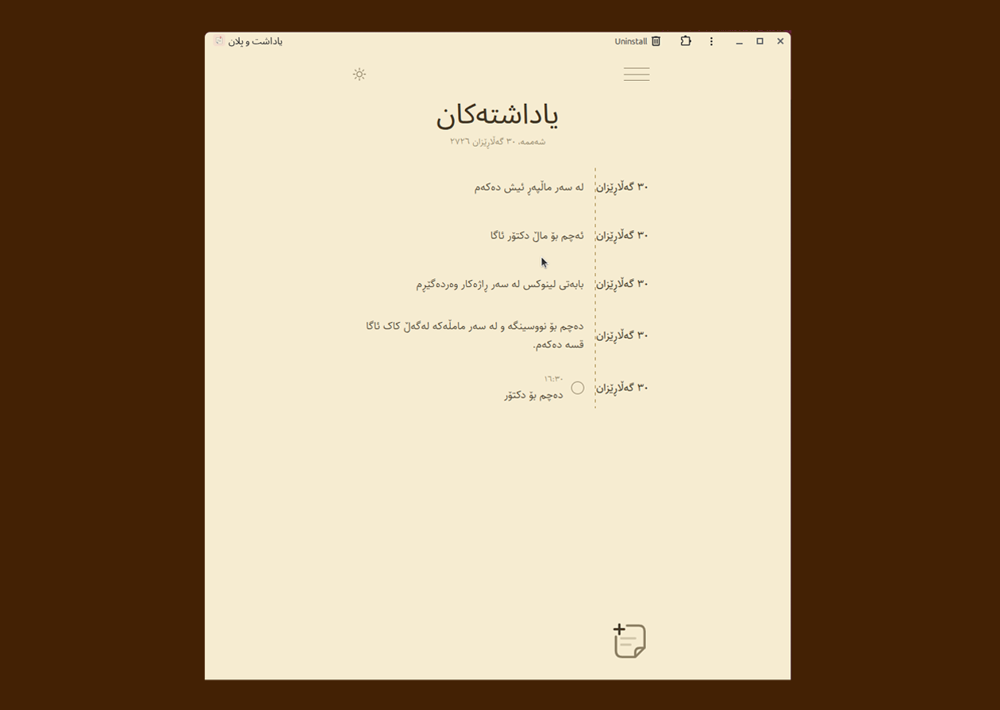

<div dir="rtl">
<p align="center">
  
</p>
# پێنووس (یاداشت و پلان)

ئەپێکی **PWA**ـی سادە و مینیمال بۆ نووسینی یاداشت و دانانی پلان، بە زمانی **کوردی (سۆرانی)**. پشتگیری فارسی و ئینگلیزیش دەکات، و سێ ڕۆژژمێری **زایینی**، **هەتاوی (جەلالی)** و **کوردی** تێدایە.

</div>

<div dir="rtl">

## ✨ تایبەتمەندییەکان

- **سێ زمان:** کوردی، فارسی، ئینگلیزی (ئاڕاستەی نووسین خۆکارانە دەگۆڕێت: ڕاست‌بۆ‌چەپ یان چەپ‌بۆ‌ڕاست).
- **سێ ڕۆژژمێر:** زایینی، هەتاوی (جەلالی)، کوردی. لە کاتی هەڵبژاردنی بەروار دەتوانیت ڕۆژژمێرەکە بگۆڕیت.
- **ژمارەی گونجاو لەگەڵ زمان:** کوردی بە ژمارەی عەرەبی-هیندی (٠١٢٣٤٥٦٧٨٩)، فارسی بە ژمارەی فارسی (۰۱۲۳۴۵۶۷۸۹)، ئینگلیزی بە ژمارەی لاتینی (0123456789).
- **یاداشت و پلان:** یاداشتی ئاسایی، یان پلان بە کات. پلانەکان بە لێدان دەتوانیت وەک ئەنجامدراو نیشانە بکەیت.
- **ڕووکار (تێم):** کا، ئاسمانی، زەیتوونی و سپی، هەریەکەیان بە دوو دۆخی ڕۆژ و شەو.
- **دۆخی ڕۆژ و شەو:** بە ئایکۆنی خۆر و مانگ لە سەرەوە دەگۆڕدرێت.
- **کاردەکات بێ ئینتەرنێت:** دوای یەکەم جار کردنەوە لە ڕێگەی Service Worker.
- **داتا لە ناو ئامێرەکەتدایە:** هیچ داتایەک بۆ سێرڤەر نانێردرێت (`localStorage`).
- **دامەزراندن لەسەر مۆبایل و دێسکتۆپ** وەک ئەپێکی ئاسایی.

</div>

<div dir="rtl">



##  پێکهاتەی فایلەکان

</div>

```
notes-pwa/
├── index.html            # ئەپەکە (HTML + CSS + JS لە یەک فایلدا)
├── manifest.webmanifest  # زانیاری PWA (ناو، ئایکۆن، ڕەنگ)
├── sw.js                 # Service Worker بۆ کارکردن بێ ئینتەرنێت
├── icon-512.png
├── icon-192.png
├── icon-180.png          # ئایکۆنی ئایفۆن
└── icon-32.png           # ئایکۆنی تابی وێبگەڕ
```

<div dir="rtl">

## 🚀 چۆن بەکاری بهێنم

### ١. تاقیکردنەوە لەسەر کۆمپیوتەرەکەت

PWA پێویستی بە `http://localhost` یان `https` هەیە، بۆیە فایلەکە بە دووبل-کلیک مەکەرەوە. لە ناو پەڕگەکە سێرڤەرێکی سادە بخەرە کار:

</div>

```bash
cd notes-pwa
python3 -m http.server 8080
# پاشان بکەرەوە: http://localhost:8080
```

<div dir="rtl">

### ٢. دامەزراندن وەک ئەپ

- **ئەندرۆید (Chrome):** مینیو ← **Install app** یان **Add to Home screen**.
- **ئایفۆن (Safari):** دوگمەی Share ← **Add to Home Screen**.
- **دێسکتۆپ (Chrome / Edge):** ئایکۆنی دامەزراندن لە ناو ستوونی ناونیشان.

</div>

<div dir="rtl">

##  بەکارهێنان

| کار | چۆن |
|---|---|
| یاداشت یان پلانی نوێ | دوگمەی یاداشتی نوێ لە خوارەوە |
| دەستکاری یان سڕینەوە | لێدان لەسەر هەر ڕیزێک |
| ئەنجامدانی پلان | لێدان لەسەر بازنەی بەر لە پلانەکە |
| گۆڕینی زمان، ڕۆژژمێر و ڕووکار | مینیوی سێ هێڵ لە سەرەوە |
| ڕۆژ / شەو | ئایکۆنی خۆر یان مانگ لە سەرەوە |
| گەڕان بۆ ئەمڕۆ | لێدان لەسەر بەرواری ژێر ناونیشان |

</div>

<div dir="rtl">

##  دەربارەی ڕۆژژمێرەکان

- **زایینی:** ڕۆژژمێری ئاسایی جیهانی، بە ناوی کوردی مانگەکان (کانوونی دووەم، شوبات، ئازار...).
- **هەتاوی (جەلالی):** ڕۆژژمێری خۆری ئێران و ئەفغانستان (فەروەردین، ئوردیبەهەشت...). گۆڕینی بەروار بە `Intl` ی وێبگەڕ ئەنجام دەدرێت.
- **کوردی:** هەمان مانگ و ڕۆژی ڕۆژژمێری هەتاوییە، بەڵام بە ناوی کوردی مانگەکان (خاکەلێوە، گوڵان، جۆزەردان، پووشپەڕ، گەلاوێژ، خەرمانان، ڕەزبەر، گەڵاڕێزان، سەرماوەز، بەفرانبار، ڕێبەندان، ڕەشەمە). ساڵی کوردی = ساڵی هەتاوی + ١٣٢١.

</div>

<div dir="rtl">

##  تەکنەلۆژی

- HTML, CSS و JavaScript ی ڕەسەن، بێ هیچ فرەیمۆرکێک
- Service Worker و Web App Manifest
- `localStorage` بۆ هەڵگرتنی داتا
- فۆنتی [ساحل (Sahel)](https://github.com/rastikerdar/sahel-font) لە ڕێگەی jsDelivr CDN

##  تێبینی

- فۆنتی ساحل لە ئینتەرنێتەوە دادەبەزێت. دوای یەکەم جار، Service Worker دەیپارێزێت.
- ژمارەی کوردی بە فۆنتی سیستەمی ئامێرەکە پیشان دەدرێت، چونکە شێوەی ٤ ٥ ٦ لە ژمارەی فارسی جیاوازە.
- داتاکان تەنها لەسەر هەمان ئامێر و هەمان وێبگەڕ دەمێننەوە. ئەگەر داتای وێبگەڕ بسڕیتەوە، یاداشتەکان دەسڕێنەوە.
- کاتێک ئەپەکە نوێ دەکەیتەوە، ڕەنگە پێویست بێت یەک جار بە ئینتەرنێت بیکەیتەوە تاکو کاشی کۆن بگۆڕدرێت.

##  مۆڵەت

ئازادیت هەیە بۆ بەکارهێنان و گۆڕین. مۆڵەتی دڵخوازی خۆت (وەک MIT) لێرە زیاد بکە.

</div>
